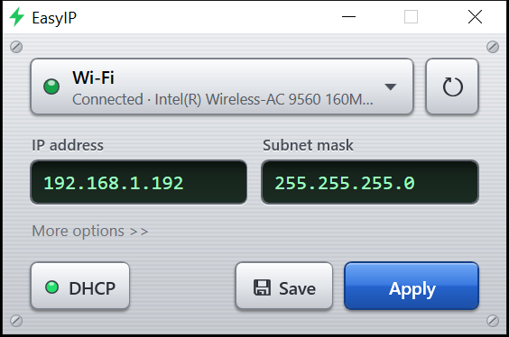
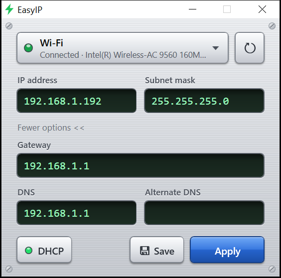
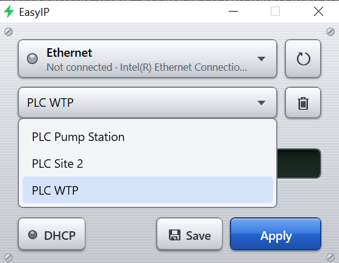

<p align="center">
  
</p>

<h1 align="center">EasyIP</h1>

<p align="center">
  Change a Windows network adapter's IP address in one click
</p>

<p align="center">
  <a href="https://github.com/osaago/EasyIP/raw/main/releases/EasyIP-Setup-1.2.0.exe"><b>Download for Windows</b></a>
</p>

<p align="center">
  
</p>

## Why I made this

EasyIP is a simple tool I created for my own work. I need to change network interface settings many times a day, and each change meant going through Control Panel, finding the adapter, opening its properties, and selecting TCP/IPv4. EasyIP saves me that trip through Windows every time.

## Features

- **See and change in one place.** The IP and mask boxes show the current values. Type over them and press Apply.
- **One-click DHCP.** Press DHCP to go back to automatic. Its light shows when DHCP is on.
- **Saved IPs.** Name the setups you use often and reload them from a list.
- **More options.** Gateway and DNS stay out of the way until you need them.
- **Mistakes caught early.** Bad addresses, masks and gateways are flagged before anything changes.
- **Safe changes.** If Windows rejects a change, your previous settings are restored.
- **Works on unplugged adapters.** Set the IP first, connect the cable later.

<p align="center">
  
  
</p>

## Download and install

1. [Download the installer](https://github.com/osaago/EasyIP/raw/main/releases/EasyIP-Setup-1.2.0.exe) (2 MB).
2. Run it. There's nothing else to install.
3. Open EasyIP from the desktop shortcut and click **Yes** on the admin prompt. Windows requires admin rights to change an IP address.

Tested on Windows 10. It should also run on Windows 8 and 11.

**About the blue "Windows protected your PC" warning:** the installer isn't code signed, so Windows may show this screen. Click **More info**, then **Run anyway**.

## How to use it

1. Pick the adapter.
2. Type the new IP address and subnet mask, then press **Apply** (or Enter).
3. To go back to automatic, press **DHCP**.

Tip: type `192.168.1.10/24` in the IP box and the mask fills in for you.

Saved IPs are in `%APPDATA%\EasyIP\settings.xml`, and every change is logged in `%APPDATA%\EasyIP\easyip.log`.

## Build from source

No SDK needed. The build uses the C# compiler included in Windows, and the installer step needs [Inno Setup 6](https://jrsoftware.org/isinfo.php).

```bash
powershell -ExecutionPolicy Bypass -File build.ps1
```

Add `-NoInstaller` to skip the installer. The app is written in C# with WPF on the .NET Framework built into Windows. Changes go through `netsh`, and each one is confirmed by reading the saved settings back from Windows.
